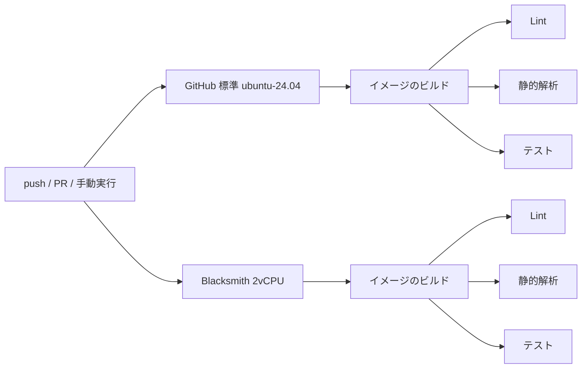

# 環境・構成

## バージョン

| 種類 | 名前 | バージョン |
|---|---|---|
| フレームワーク | Laravel | 13.35.0 |
| 言語 | PHP | 8.5（イメージ `php:8.5-cli-bookworm`） |
| DB（ローカルのみ） | MySQL | 8.4 |
| テスト | PHPUnit | 12.5 |
| 静的解析 | Larastan | 3.13（レベル 8） |
| コード整形 | Laravel Pint | 1.32 |
| Action | actions/checkout | v7 |
| Action | docker/setup-buildx-action | v4 |
| Action | docker/build-push-action | v7 |
| Action | useblacksmith/setup-docker-builder | v1 |
| Action | useblacksmith/build-push-action | v2 |

## アプリの構成

タスク管理 API。処理の流れは Controller → Service → Repository のインターフェース → Eloquent での実装。テストではリポジトリをモックに差し替える。

| メソッド | パス | 内容 |
|---|---|---|
| GET | /api/tasks | 一覧（`?status=todo/doing/done` で絞り込み） |
| POST | /api/tasks | 登録（必ず「未着手」から開始） |
| GET | /api/tasks/{id} | 詳細 |
| PATCH | /api/tasks/{id} | 更新 |
| DELETE | /api/tasks/{id} | 削除 |
| GET | /api/tasks/summary | 集計（件数・完了率・期限切れ件数） |
| GET | / | 動作確認用の画面 |

ステータスの変更ルール：未着手 → 進行中 → 完了 の順のみ。進行中から未着手には戻せる。完了からは変更できない。ルール違反は 422 を返す。

## 主なファイル

| ファイル | 役割 |
|---|---|
| `docker/php/Dockerfile` | PHP のバージョンを一元管理。開発用（`dev`）と CI 用（`ci`）のステージを持つ |
| `compose.yaml` | ローカル開発用（app と mysql） |
| `app/Repositories/TaskRepositoryInterface.php` | DB アクセスの窓口。テストではこれをモックにする |
| `tests/TestCase.php` | テスト中に SQL が発行されたら失敗させるガード |
| `phpstan.neon` | Larastan の設定 |
| `resources/views/tasks.blade.php` | 動作確認用の画面 |
| `.github/workflows/ci.yml` | GitHub 標準と Blacksmith を同時に実行する入口 |
| `.github/workflows/_ci.yml` | 再利用ワークフロー（ビルド → 3 つのチェックを並列実行） |
| `.github/actions/build-ci-image/action.yml` | イメージのビルド。ランナーに応じてキャッシュ方式を切り替える |

## CI の流れ



| 項目 | GitHub 標準 | Blacksmith |
|---|---|---|
| ランナー | `ubuntu-24.04`（2vCPU） | `blacksmith-2vcpu-ubuntu-2404` |
| Docker のキャッシュ | GitHub Actions キャッシュ（`type=gha`） | 専用ビルダーのレイヤーキャッシュ |

キャッシュなしのビルドを計測する場合は、Actions 画面から手動実行し、`no-cache` にチェックを入れる。

## ローカルでの操作

```bash
cd ~/laravel-ci-bench
docker compose up -d --wait                               # 起動（MySQL の準備完了まで待つ）
docker compose exec app php artisan migrate:fresh --seed  # テーブル作成とサンプル 20 件の投入

# CI と同じチェック
docker compose exec app vendor/bin/pint --test
docker compose exec app vendor/bin/phpstan analyse --memory-limit=1G
docker compose exec app php artisan test

docker compose down       # 停止（データは残る）
docker compose down -v    # 停止してデータも削除
```

| 用途 | アクセス先 |
|---|---|
| 動作確認画面 | http://localhost:8000/ |
| API | http://localhost:8000/api/tasks |
| MySQL | 127.0.0.1:3316（ユーザー laravel / パスワード password） |
